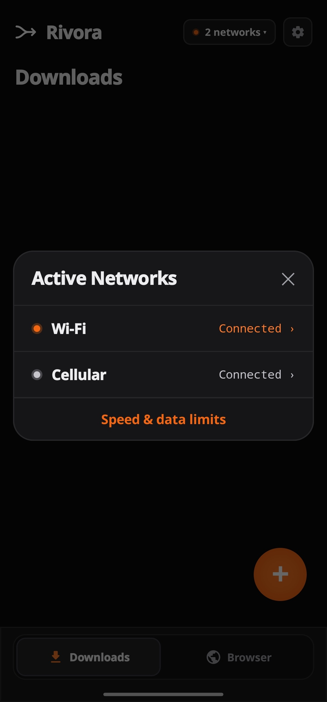
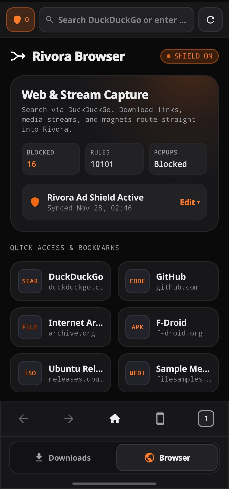
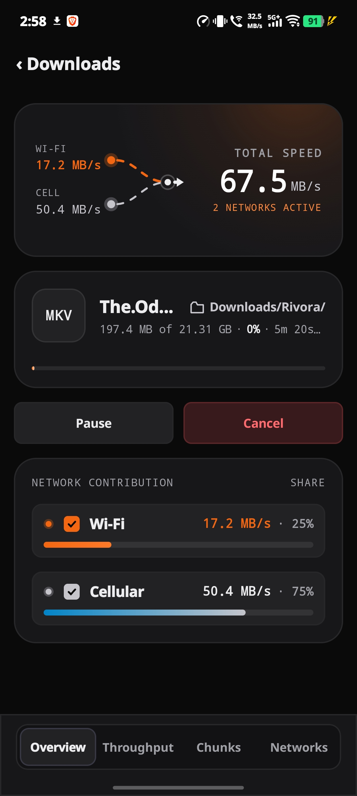
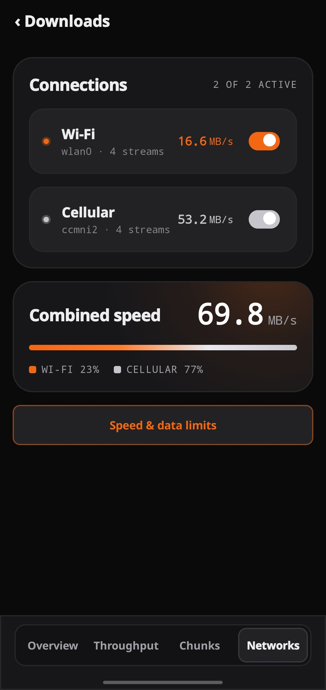
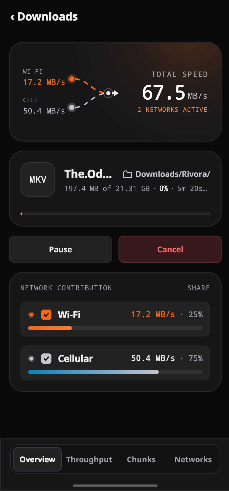

# Sonu Merger

<div align="center">

<p align="center">
  
</p>

[](https://github.com/sonu-999/Sonu-Merger/actions/workflows/release.yml)
[](https://developer.android.com)
[](https://developer.android.com/compose)
[](https://github.com/Nutlope/hallmark)

**A high-performance Android multi-network download manager, BitTorrent client, and privacy-shielded web browser.**

[Features](#features) • [Screenshots](#screenshots) • [Getting Started](#getting-started) • [Building](#building-from-source) • [Architecture](#architecture) • [Privacy](#privacy) • [Contributing](#contributing)

</div>

---

## Overview

Sonu Merger combines multi-adapter network bonding (Wi-Fi + Cellular concurrent merging), BitTorrent support, automated stream sniffer detection, and a privacy-focused browser built on the Hallmark design workbench. Built with Kotlin and Jetpack Compose for Android 7.0 (API 24) and newer.

> **Notice:** Sonu Merger is a network acceleration and browsing utility. Always ensure you have authorization to download and distribute target media.

---

## Features

### Dual-Network Merging & Download Acceleration
- Bond Wi-Fi and Cellular data streams simultaneously for maximum throughput
- Real-time chunk allocation, multi-thread chunk stitching, and per-adapter bandwidth analytics
- Resumable background downloads with persistent foreground service notifications
- Safe Android DocumentTree storage routing for custom download destinations
- Direct stream sniffer intercepting media, APKs, ISOs, and archive files

### BitTorrent Client
- High-efficiency magnet link resolution powered by libtorrent4j
- DHT, PEX, and public tracker discovery
- Sequential piece downloading support for streaming media
- Granular upload and download speed throttles

### Privacy Browser & Ad Shield (Hallmark Workbench)
- Built-in EasyList, AdAway, and Peter Lowe open-source filter lists
- O(1) subdomain and parent-domain request neutralization
- Popup, clickjacking overlay, and unprompted redirect blocker
- Cosmetic CSS element hiding for clean, clutter-free reading
- Per-site shield toggles and custom domain allowlisting
- Live intercepted activity stream console

---

## Screenshots

<div align="center">

| Active Networks | Dual-Stream Download | Network Connections | Ad-Blocking Browser | Bandwidth Limits |
| :---: | :---: | :---: | :---: | :---: |
|  |  |  |  |  |

</div>

---

## Getting started

### Download an APK

Download the latest signed release APK from the [Releases page](https://github.com/sonu-999/Sonu-Merger/releases).

Every GitHub Actions CI run on tagged releases or workflow dispatches produces a standalone `sonumerger-release-apk` artifact.

### System Requirements

- Android 7.0 (API 24) or newer
- Wi-Fi and/or Cellular connectivity
- 50 MB storage space for application and engine assets

---

## Building from source

### Prerequisites
- JDK 21
- Android SDK 36 (Android 15 / UpsideDownCake)
- Gradle 9.3+

### Clone & Build
```bash
git clone https://github.com/sonu-999/Sonu-Merger.git
cd Sonu-Merger

# Build Debug APK
./gradlew :app:assembleDebug

# Run JVM Unit Tests
./gradlew :app:testDebugUnitTest

# Build Release APK
./gradlew :app:assembleRelease
```

The output debug APK will be generated at:
```text
app/build/outputs/apk/debug/app-debug.apk
```

---

## Configuration

For optional cloud features or custom API integrations, copy `.env.example` to `.env`:

```dotenv
GEMINI_API_KEY=your_optional_api_key
```

CI release signing is driven by GitHub Secrets:
- `KEYSTORE_PATH`
- `STORE_PASSWORD`
- `KEY_PASSWORD`

---

## Architecture

Sonu Merger follows Modern Android Architecture with Jetpack Compose:

```text
app/src/main/java/com/rivora/
├── backend/            Multi-network bonding, socket chunker & torrent engine
├── browser/            WebView host, AdBlockerEngine & stream sniffer
├── theme/              Hallmark workbench color palette & typography
├── ui/
│   ├── components/     Tactile status pills, sibling stat bars & custom switches
│   ├── dialogs/        Network inspector & ad-shield cockpit
│   └── screens/        Download queue, analytics & browser
└── MainActivity.kt
```

---

## Permissions

Sonu Merger declares only essential permissions:
- `INTERNET`, `ACCESS_NETWORK_STATE`, `CHANGE_NETWORK_STATE`: Multi-network interface binding
- `FOREGROUND_SERVICE`, `FOREGROUND_SERVICE_DATA_SYNC`: Uninterrupted background downloads
- `POST_NOTIFICATIONS`: Live transfer progress in status bar
- `REQUEST_INSTALL_PACKAGES`: User-initiated APK package installer

---

## Privacy

Sonu Merger operates completely locally on your device:
- No telemetry, third-party analytics, or tracking SDKs
- Ad-blocking filter lists are evaluated strictly on-device
- Browsing sessions, cookies, and downloaded files remain private on your hardware

---

## Contributing

1. Fork the repository on GitHub: [Sonu-Merger](https://github.com/sonu-999/Sonu-Merger)
2. Create a clean feature branch (`git checkout -b feature/enhancement`)
3. Commit concise, well-documented changes
4. Verify tests pass (`./gradlew :app:testDebugUnitTest`)
5. Submit a pull request with before/after screenshots

---

## License

Sonu Merger is open-source software licensed under the MIT License.
